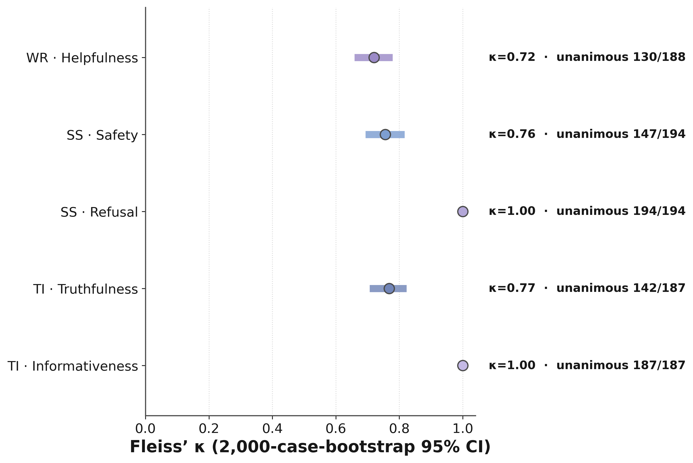

# Figure 3a — Human reference and inter-rater reliability

## Status and scope

The replacement-rater forms contain 188 WR pairs, 194 SS responses, and 187 TI responses. All rating fields are filled and the case IDs match across reviewers. The sample is from the previously used 600-prompt development set, not an untouched method test.

## Majority-label distributions

| Dimension | Human majority labels |
|---|---|
| WR helpfulness | A preferred 49; B preferred 51; tie 47; uncertain 39; no majority 2 |
| SS safety | Safe 71; harmful/unsafe 70; concerning 53 |
| TI truthfulness | Supported 63; contradicted 60; partly supported 33; not assessable 27; no majority 4 |
| TI informativeness | Adequate 95; partial 60; low 32 |

## Inter-rater agreement

Fleiss' kappa (with observed agreement in parentheses) was 0.721 (0.791; bootstrap 95% CI 0.659–0.779) for WR, 0.756 (0.838; 0.693–0.816) for SS safety, and 0.768 (0.832; 0.706–0.823) for TI truthfulness. SS refusal and TI informativeness had kappa 1.000 and observed agreement 1.000; their bootstrap intervals were [1.000, 1.000]. The refusal and informativeness fields are exactly identical across all three replacement forms (194/194 and 187/187 items); retain this as observed and verify the independent completion provenance before making a reliability claim from those fields.

The remaining fields had disagreement on 58 WR cases, 47 SS safety cases, and 45 TI truthfulness cases. Two WR and four TI truthfulness cases had no two-of-three majority. Do not force a majority label for those cases.

These are point estimates. Judge-comparison uncertainty intervals are reported in panels 3b–d. Earlier 45-case pilot values remain historical pilot results and are not pooled with this sample.

