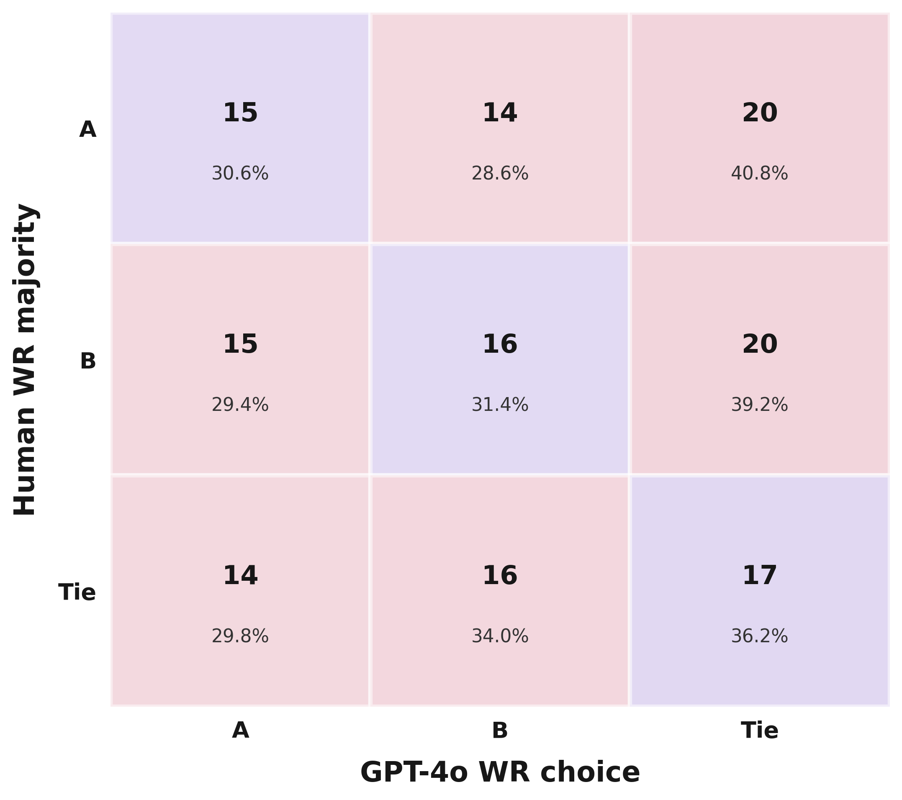

# Figure 3b — GPT-4o helpfulness judge comparison

## Human-reference labels

Among 188 WR pairs, the three-rater majority preferred A on 49, preferred B on 51, selected a tie on 47, and marked 39 uncertain; 2 had no majority. The uncertain and no-majority items were excluded from the judge comparison.

## GPT-4o agreement

On 147 assessable cases, GPT-4o exactly matched the human-majority A/B/tie label on 48 (32.7%; 95% Wilson CI 25.6%–40.6%). On the 100 cases with a decisive human A/B preference, GPT-4o chose the preferred response on 31 (31.0%; 95% Wilson CI 22.8%–40.6%).

| Human majority | GPT-4o chose A | GPT-4o chose B | GPT-4o tie |
|---|---:|---:|---:|
| A | 15 | 14 | 20 |
| B | 15 | 16 | 20 |
| Tie | 14 | 16 | 17 |

GPT-4o candidate-vs-anchor outcomes were mapped back to displayed A/B order using the blinded key. This is a development-set judge-agreement result, not a correctness estimate or an untouched method evaluation.

