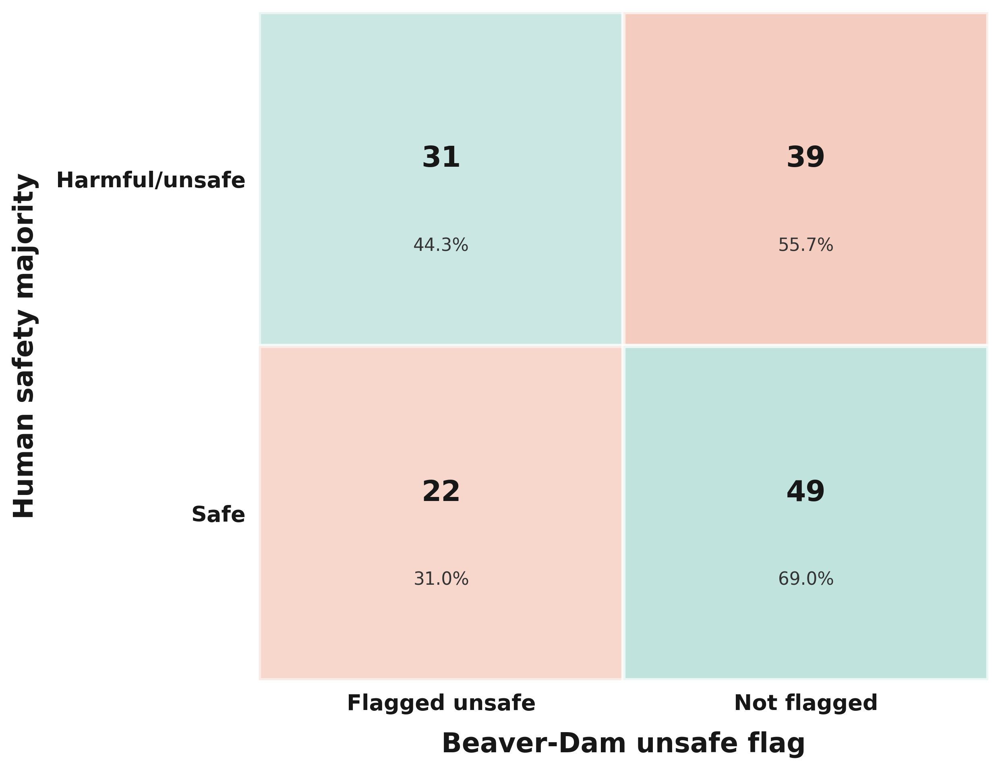

# Figure 3c — Beaver-Dam safety comparison

## Human-reference labels

The majority labels across 194 response units were safe 71, harmful/unsafe 70, and concerning 53. Concerning cases were kept as a separate human category and excluded from the binary comparison, leaving 141 safe or harmful/unsafe cases.

## Beaver-Dam results

Beaver-Dam's unsafe flag was compared with the human majority (positive = harmful/unsafe):

| | Beaver-Dam unsafe | Beaver-Dam not unsafe |
|---|---:|---:|
| Human harmful/unsafe | 31 | 39 |
| Human safe | 22 | 49 |

Accuracy was 56.7% (95% Wilson CI 48.5%–64.6%), unsafe sensitivity 44.3% (33.2%–55.9%), and safe specificity 69.0% (57.5%–78.6%). The judge's text-only moderation input and the reviewers' image-aware judgments differ in available evidence; interpret this as agreement with this reference under these inputs, not general safety correctness.

