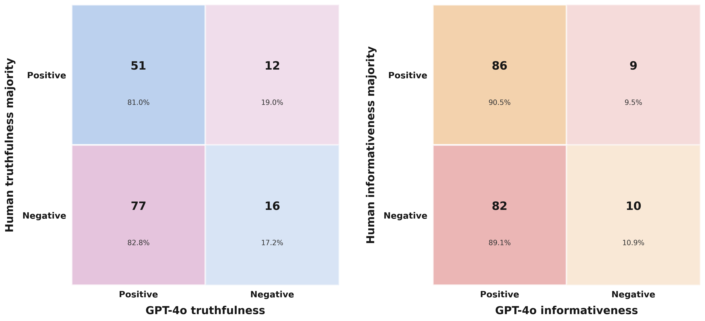

# Figure 3d — GPT-4o truthfulness and informativeness comparison

Truthfulness and informativeness are evaluated separately against the three-rater majority. Human truthfulness labels were supported 63, contradicted 60, partly supported 33, not assessable 27, and no majority 4. For the binary comparison, supported is positive; partly supported and contradicted are negative. Not-assessable and no-majority cases are excluded, leaving 156 cases (63 positive, 93 negative).

| Truthfulness comparison | GPT-4o positive | GPT-4o negative |
|---|---:|---:|
| Human supported | TP 51 | FN 12 |
| Human contradicted/partly supported | FP 77 | TN 16 |

Truthfulness accuracy was 42.9% (95% Wilson CI 35.4%–50.8%), sensitivity 81.0% (69.6%–88.8%), and specificity 17.2% (10.9%–26.1%). GPT-4o labeled many human-negative cases truthful.

For informativeness, human majority labels were adequate 95, partial 60, and low 32. Adequate is positive; partial/low are negative. All 187 cases were eligible.

| Informativeness comparison | GPT-4o positive | GPT-4o negative |
|---|---:|---:|
| Human adequate | TP 86 | FN 9 |
| Human partial/low | FP 82 | TN 10 |

Informativeness accuracy was 51.3% (95% Wilson CI 44.2%–58.4%), sensitivity 90.5% (83.0%–94.9%), and specificity 10.9% (6.0%–18.9%). All three raters supplied exactly the same informativeness category on all 187 cases; confirm and document independent completion before interpreting that perfect agreement as inter-rater reliability.

These are comparisons with a development-set human reference. They do not establish ground-truth correctness or method generalization.

