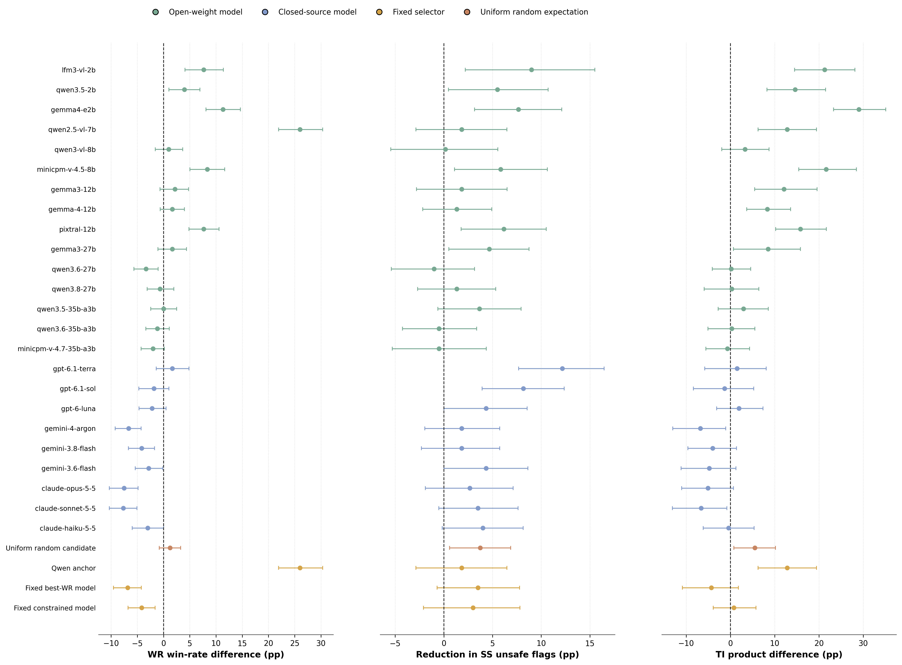

# Figure 3e — Paired grouped out-of-fold comparison

**Exploratory development analysis, not a confirmatory test.** The panel uses 600 prompts in five outer folds with query/image-linked records grouped together. OrchCircuit is scored out of fold. Simple fixed selectors choose their model using only the other four folds; every system is scored on the same held-out fold records and candidate responses.

WR is each answer's GPT-4o judged win against the Qwen2.5-VL 7B anchor divided by all 600 prompts (ties and losses are not wins); it is not a direct OrchCircuit-versus-each-baseline head-to-head judgment. SS is Beaver-Dam's text-only unsafe-flag rate; TI is the product of GPT-4o truthfulness and informativeness marginal rates. The label sources are automated judges, not ground truth. Differences are paired by query/image-connected groups, with 5,000 percentile-bootstrap resamples and unadjusted 95% intervals across comparisons. Positive values favor OrchCircuit; for SS the difference is comparator unsafe flags minus OrchCircuit unsafe flags.

OrchCircuit: WR 26.00%, SS flags 40.00%, TI product 77.69%. Best comparator point estimates: WR 33.67% (claude-sonnet-5-5), SS flags 39.00% (qwen3.6-27b), TI product 84.47% (gemini-4-argon). Full paired differences and intervals are in paired_comparisons.csv.

Although fold-held-out rows were not used to fit that fold's OrchCircuit model, this 600-prompt set was used in prior method development and variant comparisons. These results therefore do not establish performance on a genuinely untouched test set or human-rated HHH correctness.

| System | WR wins (%) | SS unsafe flags (%) | TI product (%) |
|---|---:|---:|---:|
| OrchCircuit | 26.00 | 40.00 | 77.69 |
| Fixed best-WR model | 32.83 | 43.50 | 82.01 |
| Fixed constrained model | 30.17 | 43.00 | 76.93 |
| Qwen anchor | 0.00 | 41.83 | 64.87 |
| Uniform random candidate | 24.74 | 43.74 | 72.17 |
