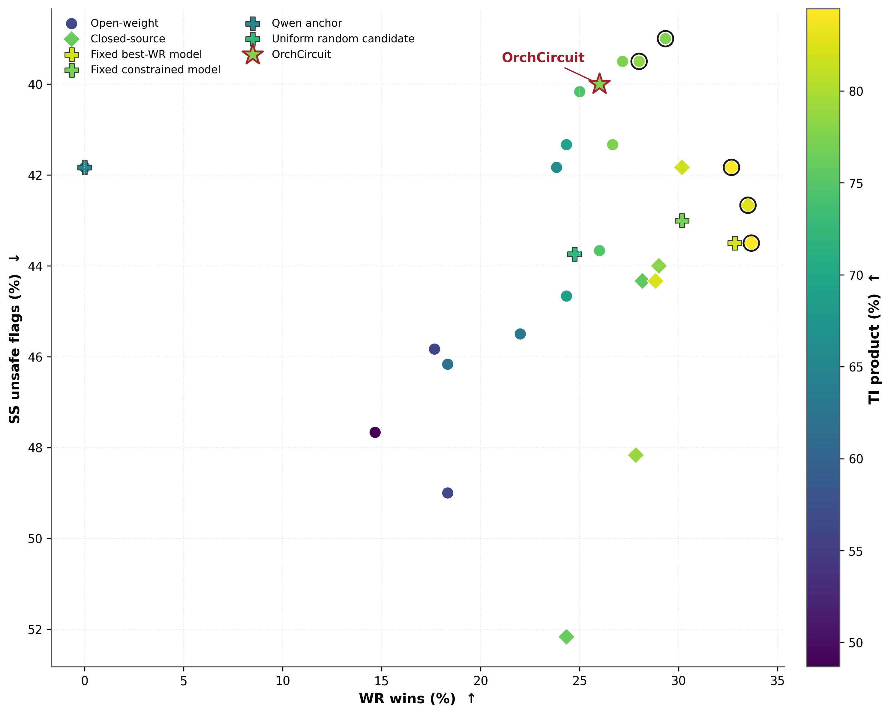

# Figure 3f — Three-objective trade-off

**Exploratory development analysis on the same 600 grouped out-of-fold prompts as Figure 3e.** WR wins and TI product are maximized; SS unsafe flags are minimized. The three outcomes remain separate: the scatter uses WR on x, SS on y (reversed so fewer flags plot higher), and color for TI product. Open-weight and closed-source baselines use different markers; simple fixed rules and OrchCircuit are distinguished in the legend. Outlined model points are nondominated under the three point estimates. Exact scores and Pareto labels are in tradeoff_metrics.csv.

Point-estimate nondominated systems: qwen3.6-27b, minicpm-v-4.7-35b-a3b, gemini-4-argon, claude-opus-5-5, claude-sonnet-5-5. Nondominance is descriptive, not evidence of statistical superiority. Scores are automated-judge outputs and do not establish human-rated correctness or generalization to a fresh test set.

